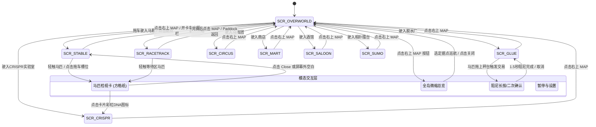
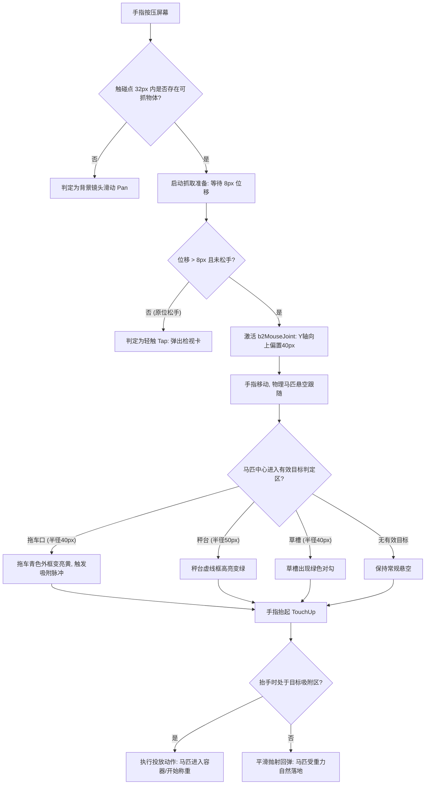

# 《Horsey Game》有道词典笔移植界面布局与触控交互规格说明书

## 0. 一句话核心决策

将原版 16:9 画布的“上下夹层 HUD + 自由居中观察”重构为**“左右功能翼 + 中央无界横卷轴舞台 + 40px 垂直偏置提线抓取”**；代价是放弃原版纵向全景视野与自由滚轮缩放，所有场景镜头高度被裁切锁定在地面上方有限带状空间。

---

## 1. 屏幕清单与切换图

### 1.1 屏幕层级与模式划分

整个游戏在 800×220 视口下划分为三类视图：
1. **基础物理场景（全屏视口）**：
   - `SCR_OVERWORLD`：顶视大地图（大岛 12800×7200 px）
   - `SCR_STABLE`：马厩与围场（Paddock / Barn）
   - `SCR_RACETRACK`：赛马场与常驻下注面板（Race Track）
   - `SCR_CRISPR`：CRISPR 实验室与基因翻牌台
   - `SCR_GLUE`：胶水厂（Sue's Glues）
   - `SCR_CIRCUS`：马戏六棚（Circus）
   - `SCR_MART`：商店（Horse-Mart）
   - `SCR_SALOON`：酒馆（Saloon）
   - `SCR_SUMO`：相扑馆（Sumo Ring）
2. **全屏模态层（覆盖于基础场景之上，背景 60% 遮罩）**：
   - `MODAL_INSPECT`：马匹检视卡（方格纸风格）
   - `MODAL_MAP_OVERVIEW`：全岛鸟瞰微缩地图与快速旅行
   - `MODAL_CONFIRM_DESTRUCT`：毁灭性操作确认（胶水厂、放生）
   - `MODAL_PAUSE`：暂停菜单（音量、统计信息、返回）
3. **微型 HUD 悬浮层（常驻最顶层，穿透点击）**：
   - `HUD_GLOBAL`：左上金钱 `$NNNN`、右上 `MAP` 按钮、马厩特有的 `Sleep` 按钮

### 1.2 状态跳转拓扑图



---

## 2. 每屏线框规格（800×220 CSS 真实坐标）

### 2.1 全局 HUD 规范（常驻所有室内与室外）
- **坐标与尺寸**：
  - 顶部透明保护带：`X: 0, Y: 0, W: 800, H: 22`（不阻挡下方物理碰撞，仅内部组件接收触摸）。
  - 金钱显示牌（左上）：`X: 4, Y: 2, W: 72, H: 18`。白底黑边（1px），绿色粗体数字（`#198c19`，11px），数值变动时右侧浮现 `+50` / `-25` 灰色渐隐数字。
  - 当前据点标签（紧随金钱牌）：`X: 80, Y: 2, W: 110, H: 18`。深灰底（`#333`），黄色文字（`#ffd700`，10px），显示 `STABLE` / `C.R.I.S.P.R. LAB` 等。
  - 右侧功能组：
    - `Sleep ☾` 按钮（仅在 `SCR_STABLE` 出现）：`X: 686, Y: 2, W: 52, H: 18`。浅蓝白底深蓝框，文字 10px。
    - `MAP 🚗` 按钮：`X: 742, Y: 2, W: 54, H: 18`。白底红框（1px），红色卡车图标 + "MAP" 粗体 10px。
    - 暂停/汉堡按钮：集成于 MAP 按钮侧边或通过双指轻触唤出。

---

### 2.2 屏幕 1：马厩与围场（SCR_STABLE）

```
+----------------------------------------------------------------------------------------------------+ (0,0)
| [$1280] [STABLE]                                                                 [Sleep ☾] [MAP 🚗] | (H:22)
|----------------------------------------------------------------------------------------------------|
|  木质谷仓墙面与窗户背景 (Y: 22 ~ 140)                                                               |
|                                                                                                    |
|                                       [马匹状态泡 *neigh*]                                           |
|                                        +-------------------+       [干草水槽 Hay Trough]            |
|                                        | 自由漫步的马匹刚体 |       X: 580, Y: 140                   |
|                                        | W: 72, H: 48      |       W: 80, H: 40                     |
|  +--------------------+                +-------------------+                                        |
|  | 随身拖车 Trailer   |                                                                             |
|  | X: 6, Y: 148       |                                                                             |
|  | W: 130, H: 66      |============================================================================| (Y:140 地面)
|  | [槽1:3y] [槽2:5y]  | 泥土草地表面 (Y: 140 ~ 220)                                                 |
|  +-(O)------------(O)-+                                                                             |
+----------------------------------------------------------------------------------------------------+ (800,220)
```

- **元素规格明细**：
  1. **随身拖车（Trailer）**：
     - 位置与尺寸：`X: 6, Y: 148, W: 130, H: 66`。
     - 外观：白色箱体、青色描边（`border: 3px solid #00a896`），底部两枚直径 12px 轮子。
     - 内部容量：4 个并排槽位（每个 `W: 28, H: 40`），每个槽位展示马匹微缩简影、编号与年龄标签（如 `3y`）。
     - 交互：点击槽位直接呼出该马检视卡；从拖车内向外拖拽即为放生或转移至马厩；从外部拖入即为收纳。
  2. **活动马匹（Ragdoll Entity）**：
     - 尺寸：根据基因 `SIZE` 动态生成，标准马匹包围盒约为 `W: 72, H: 48`。
     - 交互：短触弹出检视卡；按下并移动启动提线抓取；双击触发 `G` 动作（走起）。
  3. **草料槽（Hay Trough）**：
     - 位置与尺寸：`X: 580, Y: 140, W: 80, H: 40`。作为喂食吸附判定区。

---

### 2.3 屏幕 2：赛马场与下注（SCR_RACETRACK）

```
+----------------------------------------------------------------------------------------------------+ (0,0)
| [$1280] [RACE 8 · 8 FURLONG]                                                               [MAP 🚗] | (H:22)
|---------------------------------------------------------+------------------------------------------|
| 赛跑跑道区域 (X: 0 ~ 530, Y: 22 ~ 220)                   | 常驻下注控制面板 (X: 530 ~ 800, Y: 22 ~ 220) |
| [1] Clover (3-1)    [🐎]                                | [BETTING SLATE]             [Prize: $500]| (H:24)
|----------------------------------------------------|    |------------------------------------------|
| [2] Titanium (7-1)      [🐎]                       |终   | 1. Clover (3-1)   [Win?] [Place?] [Show?]| (H:30)
|----------------------------------------------------|点   | 2. Titanium (7-1) [Win?] [Place?] [Show?]| (H:30)
| [3] Lasagna (12-1)  [🐎]                           |线   | 3. Lasagna (12-1) [Win?] [Place?] [Show?]| (H:30)
|----------------------------------------------------|    | 4. Zeke (2-1)     [Win?] [Place?] [Show?]| (H:30)
| [4] Zeke (2-1)          [🐎]                       |    |------------------------------------------|
|----------------------------------------------------|    | 下注金额: [-] [$25] [+]    [ START RACE! ]| (H:36)
+---------------------------------------------------------+------------------------------------------+ (800,220)
```

- **空间让步裁决**：
  - 左侧 530px 为赛道区，展示 4~5 条跑道（每条高度 36px），马匹沿水平方向奔跑，天然契合 3.64:1 横带视野。终点线（Finish Line）位于 `X: 490`。
  - 右侧 270px（`X: 530 ~ 800`）设立常驻下注面板，绝不采用遮挡视线的弹窗。
- **下注面板（Betting Slate）规格**：
  - 顶栏：`H: 24`，展示当前奖金（`Prize: $500`）与场次。
  - 马匹投注行（4~5 行，每行 `H: 30`）：
    - 左侧：马号方块（`20×20`）、马名截断显示、赔率（如 `3-1`）。
    - 右侧按键组：`Win?`（单胜）、`Place?`（前两名）、`Show?`（前三名）三个并排触控胶囊。未解锁的票种呈现浅灰锁止态。
  - 底栏操作区（`H: 36`）：
    - 步进器：`[-]`（`24×24`）、金额框（`$25`，`44×24`）、`[+]`（`24×24`）。
    - 启动按钮：`START RACE!`（`X: 710, Y: 184, W: 84, H: 30`），高亮绿色纯色块。

---

### 2.4 模态层：马匹检视卡（MODAL_INSPECT）

```
+----------------------------------------------------------------------------------------------------+
| 全局半透明深黑遮罩 (RGBA 0,0,0,0.6)                                                                 |
|         +--------------------------------------------------------------------------------+         |
|         | 白底淡蓝方格纸面板 (X: 90, Y: 15, W: 620, H: 190)                              |         |
|         |-----------------------------------+--------------------------------------------|         |
|         | 左栏: 视觉剪影 (W: 160)            | 右栏: 详细生理参数 (W: 460)                 |         |
|         |                                   | 马名: [ Fettuccine Alfredo ✎ ]   [ CLOSE ] | (H:26)  |
|         |    +-------------------------+    |--------------------------------------------|         |
|         |    | 该马侧视实时像素剪影    |    |  Age:     4 / 8        Races:  5 (3 Wins)  | (H:22)  |
|         |    | W: 140, H: 80           |    |  Height:  16.7         Weight: 840 lb      | (H:22)  |
|         |    +-------------------------+    |  Parents: Minty Fresh × Zeke               | (H:22)  |
|         |                                   |  Offspring: 02 (Murder She Wrote, ...)     | (H:22)  |
|         |    [ 🏆 CHAMP ] [ 🎗 RIBBON ]    |--------------------------------------------|         |
|         |                                   |  状态: 饱腹 / 精力充沛                     | (H:24)  |
|         |    [ 🧬 CRISPR 基因改造 ]         |  资格: 具备冠军赛资格 (Won 2 Races)        |         |
|         +-----------------------------------+--------------------------------------------+         |
+----------------------------------------------------------------------------------------------------+
```

- **布局取舍与规格**：
  - 面板居中尺寸：`W: 620, H: 190`，外边框为 `2px solid #2980b9`，内部背景为 `12×12 px` 淡蓝色印刷方格纸网格。
  - 左栏（`W: 160`）：放置实时渲染的马匹程序化剪影（`140×80`）、获得的状态徽章（相扑腰带、缎带、奖杯等），底部放置彩虹 DNA 按钮进入基因工坊。
  - 右栏（`W: 460`）：
    - 马名点击即可触发改名浮层。
    - 严格遵循逆向提取的标签字段顺序：`Age`（显示当前/寿命上限，如 `4/8`）、`Races`、`Ht`（一位小数）、`Wt`（整数磅）、`Parents`（无记录显示 `Unknown`）、`Offspring`（两位补零）。
    - 右上角设立显式绿色 `CLOSE` 按钮（`W: 56, H: 22`），点击或按任意卡片外空白区域均可收起。

---

### 2.5 屏幕 3：CRISPR 实验室（SCR_CRISPR）

```
+----------------------------------------------------------------------------------------------------+ (0,0)
| [$1280] [C.R.I.S.P.R. LAB]                                                                [MAP 🚗] | (H:22)
|----------------------------------------------------------------------------------------------------|
| [部位分类Tab] | [基因属性列表]      | [4碱基翻牌装配器 (X: 270 ~ 790, Y: 24 ~ 214)]                 |
| W: 70        | W: 180              |                                                               |
| [四肢/步态]  | > LEG_LENGTH  [ATGC]| 当前基因: LEG_LENGTH (Helix 4)            显性位: Pos 0 (A)   |
| [体型/骨骼]  |   KNEE_MAX    [TTGA]|                                                               |
| [头部/器官]  |   LOCO_SYNC   [CGTA]|      +------+     +------+     +------+     +------+          |
| [毛色/特征]  |   HOOF_GRIP   [AATT]| 槽位 | Pos 0|     | Pos 1|     | Pos 2|     | Pos 3|          |
|              |   CHEST_BIG   [GCAT]|      |  A   |     |  T   |     |  G   |     |  C   |          |
|              |   NECK_ANGLE  [TTAA]|      +------+     +------+     +------+     +------+          |
|              |                     |      (当前选中)                                               |
|              |                     |---------------------------------------------------------------|
|              |                     | 替换候选库:  [ A ]    [ T ]    [ G ]    [ C ]   [ 确认注入 ]  |
+----------------------------------------------------------------------------------------------------+ (800,220)
```

- **降级逻辑**：原版 240 个基因在窄屏上无法单列滚动。重构为**三级横向解构**：
  1. 一级解剖部位（左侧 70px）：4 个分类标签；
  2. 二级基因属性（中间 180px）：纵向滚动展示当前分类下的 6~10 个基因，展示基因名称与当前等位组合；
  3. 三级碱基翻牌器（右侧 520px）：展示 4 个大号碱基卡牌（每个 `W: 44, H: 52`），点击卡牌后，在下方直接轻触 A/T/G/C 大按钮完成单点基因替换。

---

### 2.6 屏幕 4：胶水厂（SCR_GLUE）

```
+----------------------------------------------------------------------------------------------------+ (0,0)
| [$1280] [SUE'S GLUES]                                                                     [MAP 🚗] | (H:22)
|----------------------------------------------------------------------------------------------------|
| 招牌: NOW PAYING 3 CENTS/LB (X: 20, Y: 26)                                                         |
|                                                                                                    |
|   +--------------------+     +----------------------------------+     +--------------------------+ |
|   | 随身拖车 Trailer   |     | 地磅秤台 Weighing Platform       |     | 结算与确认安全区         | |
|   | X: 20, Y: 130      |     | X: 220, Y: 110, W: 240, H: 90    |     | X: 510, Y: 90            | |
|   | W: 130, H: 70      |     | 刻度: 0 .. 1000 .. 2000 .. 3000  |     | W: 270, H: 115           | |
|   |                    | --> | 当前读数: 840 lb = $25.20        | --> | ⚠ 销毁后不可逆！         | |
|   |                    |     |                                  |     | [ 长按 1.5 秒确认出售 ]  | |
|   +-(O)------------(O)-+     +----------------------------------+     +--------------------------+ |
+----------------------------------------------------------------------------------------------------+ (800,220)
```

- **核心流程**：
  1. 玩家从拖车中抓取马匹并悬空拖拽；
  2. 放置到地磅秤台上，指针根据 `Wt` 实时偏转，上方数字显示实际计算结果（例如 `840 lb × $0.03 = $25.20`）；
  3. 右侧结算区激活，玩家必须执行长按操作才执行不可逆操作。

---

## 3. 手势与输入映射表

词典笔无鼠标悬停，且无物理键盘。原版所有光标状态与快捷键均转译为明确的触屏手势：

| 原版光标/按键 | 语义与触发条件 | 词典笔手势与交互机制 | 视觉与音效反馈 |
|---|---|---|---|
| `Pointer` | 默认空闲指针 | 默认状态，屏幕无指示，单指触摸即响应 | 对应实体轻微下陷 |
| `PointerPet` | 鼠标悬停在马身上抚摸 | **长按马身不动（≥350ms）** 或在马身上轻柔左右摩擦两次 | 马头冒出爱心与 `*neigh*` 气泡，发出安抚嘶鸣音效 |
| `PointerInspect` | 悬停查看信息 | **轻触马身（Tap，抬手时间 < 250ms）** | 展开 `MODAL_INSPECT` 检视卡 |
| `GrabHand` / `2` | 鼠标按住马匹或物品拖动 | **按住并移动（TouchDown + Move > 8px）** | 触发提线悬吊态，马匹物理关节松弛甩动，出现抓取音效 |
| `PointerDig` | 装备铲子悬停在粪球/挖掘点 | 选中铲子道具后，**直接轻触地表粪球或泥坑** | 播放铲土动画，粪球化为金币飞入左上角钱袋 |
| `PointerEat` | 食物喂给马匹 | 拖动干草至马嘴附近，或**直接点击马头顶的饥饿气泡** | 触发进食动画，扣除背包干草，马匹饱腹度恢复 |
| `PointerTalk` | 悬停在 NPC 上交谈 | **轻触 NPC 身体** | 头顶弹出对话气泡，轻触气泡推进对话文本 |
| `PointerEnter` | 悬停在建筑大门进入 | **轻触建筑入口门洞高亮区** | 触发场景过渡（黑屏淡入 150ms），切换至室内场景 |
| `PointerGo` | 卡车导航目标点 | 在大地图路面上**轻触任意点** | 地面浮现 `DriveDest` 靶心标记，卡车自动沿道路寻路开往该点 |
| `PointerLasso` | 套索瞄准掷出 | 选中套索后，**从屏幕左侧朝野马方向划出直线手势（Swipe）** | 套索沿划线矢量飞出，命中后自动缠绕并将野马牵引至拖车旁 |
| `PointerPan` | 方向键平移跑道/大地图镜头 | **在无实体空白区域单指拖动（Screen Pan）** | 镜头按拖动位移平滑滚动，带惯性回弹 |
| `PointerText` | 点击改名 | **轻触检视卡上的马名文本** | 唤出笔端内置虚拟软键盘或预设词库选择器 |
| `Esc` | 暂停菜单 | **双指同时轻触屏幕任意区域**，或点击顶部暂停微标 | 弹出 `MODAL_PAUSE` 界面，背景物理模拟暂停 |
| `E` | 关闭弹窗 / 快速退回大地图 | **点击弹窗右上角显式 [CLOSE]**，或在边缘向内右滑（Back 手势） | 模态窗口淡出，恢复底层场景 |
| `Space` | 推进对话文本 | **轻触正在说话的角色对话框本身** | 文本立刻打字完成，再次轻触进入下一句 |
| `F` | 提取目标 DNA | 选中注射器工具后，轻触目标马匹 | 提取 DNA 动画，生成基因样本加入背包 |
| `G` | "Giddy up"（让马走起） | **快速双击马身（Double Tap）**，或点击检视卡旁的驱动马鞍图标 | 马匹昂首嘶鸣并前蹄离地向前冲刺小跑 |

---

## 4. 命中区与排版规格

### 4.1 物理尺寸与触控可达性转换
- 词典笔物理视口约 `58mm × 16.5mm`，分辨率 `800 × 220 CSS px`。
- 换算比率：`1mm ≈ 13.3 CSS px`，`1 CSS px ≈ 0.075mm`。
- 成人指腹接触面通常为 `7mm ~ 9mm`（对应 `93 ~ 120 CSS px`），指尖精准点击接触面约 `4.5mm`（对应 `60 CSS px`）。

### 4.2 触控命中区硬性规则
1. **主行动大按钮（Race Start, Confirm, Map）**：
   - 视觉尺寸：`≥ 80 × 32 px`。
   - 物理投影：`≥ 6.0mm × 2.4mm`。
   - 触控热区（Padding 扩展）：`100 × 44 px`（物理 `7.5mm × 3.3mm`）。
2. **次级与列表项按钮（Bet Win?, Stepper +/-, Close）**：
   - 视觉尺寸：`≥ 44 × 26 px`。
   - 物理投影：`≥ 3.3mm × 1.9mm`。
   - 触控热区（扩展透明边距）：`≥ 44 × 36 px`（确保纵向不易点错至相邻行）。
3. **微型状态图标与气泡（Horse Bubble, Trailer Slot）**：
   - 视觉尺寸：`≥ 24 × 24 px`。
   - 触控代理热区：以中心点向外辐射半径 `R = 24px` 的圆形透明判定区。

### 4.3 字号阶梯与排版体系
为保证低分辨率下的像素锐度与清晰可读性，严禁使用非整数像素平滑抗锯齿字体，统一采用点阵风格等宽字体：

| 级别 | 字号 (CSS px) | 对应物理高度 | 像素矩阵高度 | 应用场景 |
|---|---|---|---|---|
| Display 大标题 | 16px | 1.20mm | 16 点阵 | 场景大招牌（`C.R.I.S.P.R. LAB`）、完赛胜出宣告 |
| Title 中标题 | 14px 粗体 | 1.05mm | 14 点阵 | 检视卡马名（`Hay Fever`）、下注面板表头 |
| Body 正文/数值 | 11px ~ 12px | 0.85mm ~ 0.90mm | 11 点阵 | 金额（`$1280`）、检视卡数值（`Age: 4/8`、`Wt: 840`） |
| Label 紧凑标签 | 9px ~ 10px | 0.68mm ~ 0.75mm | 9 点阵 | 拖车角标（`3y`）、赔率标识（`odds 4-1`）、地磅分度值 |

### 4.4 纯色板色值引用规范
严禁使用渐变、投影与模糊滤镜，所有着色全部使用原版纯色块：
- 牧场绿：`#27ae60`；泥土棕：`#8b5a2b`；深木褐：`#5c3a21`
- 金币绿：`#198c19`；警示/下注红：`#e74c3c`；拖车青：`#00a896`
- 方格纸蓝：`#d4e6f1`；方格纸底：`#f4faff`；马名橙：`#d35400`
- 胶水厂暗酒红：`#4a151b`；CRISPR 紫红：`#2c1a4d`；碱基黄色：`#f1c40f`

---

## 5. 拖拽与吸附规格

### 5.1 手指遮挡补偿机制：40px 垂直偏置提线抓取
- **遮挡问题根由**：屏幕物理高度仅 16.5mm，若将抓取点（`b2MouseJoint`）设定在触摸点正下方，手指按压马身时，指腹直接覆盖整个马体和地面目标，玩家无法观察姿态与目标孔位。
- **提线补偿方案**：
  - 当触发抓取后，物理约束锚点并不位于触控点，而是自动向正上方偏置 **40 CSS px**（物理距离约 3mm）。
  - 马匹悬挂在手指上方 40px 空中，马体各肢体完全暴露在手指视野之外。
  - 触控接触点与马匹悬挂点之间绘制一条 1px 黄色垂直提线（`tether`），手指在下方如同牵线木偶般引导移动。

```
       [ 悬空马匹刚体 W:72, H:48 ]  <--- 肢体完全可见，不受指腹遮挡
                    |
                    | (40px 垂直偏置提线)
                    |
          ( ( 手指触控真实落点 ) )   <--- 落在马体下方操作空白带
```

### 5.2 拾取与吸附全流程判定



- **失败判定与防脱手**：若拖动至屏幕外边缘或未命中任何容器即松开，马匹以当前拖曳速度赋予初始线速度释放（Box2D 惯性甩出并受重力落地），绝不瞬移或卡死在边界外。

---

## 6. 不可逆操作的安全设计

游戏中存在三类永久毁灭性操作：
1. **胶水厂称重处理（3 cents/lb 绞马）**
2. **野外拖出拖车放生（Drag horse outside trailer to set free）**
3. **退役寄养/出售（$100 / Studding）**

在 2.4 英寸狭小触屏上，单次轻触极易由于颠簸或手指误按造成不可挽回的存档损失。本方案设计**双重物理阻尼确认机制**，坚决不采用易被连击跳过的传统确定/取消弹窗。

### 6.1 阻尼长按机制（Hold to Execute）
- **触发场景**：马匹被拖入胶水厂秤台后。
- **界面行为**：
  - 屏幕右侧弹出不可逆警示浮层，显示红底警告文案与预计收益金额（`$25.20`）。
  - 下方提供长按确认槽：`W: 240, H: 36`。
  - 玩家必须单指按住按钮保持 **1.5 秒（1500ms）**。
  - 按钮内部带有自左向右匀速推进的红色进度填充条，伴随递增频率的咔哒倒计时音效。
  - **中途松手或手指滑出按钮**：填充条瞬间归零，操作立即中止。
  - **读满 1.5 秒**：触发绞碎音效与金币入账，马匹从存档名册中注销。

### 6.2 拖车放生放行锁（Trailer Release Latch）
- **触发场景**：从拖车内部向拖车外部野外地面拖拽马匹。
- **界面行为**：
  - 当马匹刚拖出拖车边缘时，拖车上方浮现悬浮红字：`< Drag to screen center & HOLD 1s to release >`。
  - 玩家必须将马匹拖拽至屏幕中央的虚线释放圈，并保持静止停留 1 秒，圈内进度环转满后马匹方才脱离归属权变为野马。若中途放手，马匹自动缩回拖车槽位。

---

## 7. 性能预算表与降级策略

### 7.1 硬件性能上限核算
- **主控平台**：Rockchip RK3562，四核 Cortex-A53 @ 2.0GHz。
- **图形与运行环境**：Mali-G52 GPU，Weston 合成器，Falcon 小程序 WebView（基于 QuickJS + Canvas 2D / WebGL 上下文）。
- **瓶颈定位**：A53 架构单核算力极其有限，在 JavaScript 环境中运行 Box2D（planck.js）进行多刚体迭代求解开销巨大，同屏解算超过 4 匹完整骨骼马匹即会出现掉帧。

### 7.2 每屏负载硬预算

| 场景名称 | 最大活跃布娃娃数 | 最大同屏静态刚体 | 粒子发生器上限 | DrawCall 预算 | 目标帧率 |
|---|---|---|---|---|---|
| `SCR_STABLE` (马厩) | 2 匹（玩家操作马 + 互动马） | 8（墙壁、地面、槽、拖车） | 10（咀嚼草屑、Zzz气泡） | ≤ 25 | 60 FPS |
| `SCR_RACETRACK` (赛马) | 4 匹（赛马采用轻量化刚体） | 6（跑道边界、终点柱） | 20（马蹄扬尘、终点彩带） | ≤ 30 | 55~60 FPS |
| `SCR_OVERWORLD` (大地图) | 0（野马降级为无物理Sprite）| 1（仅卡车具备刚体碰撞）| 0（关闭所有自然粒子） | ≤ 18 | 60 FPS |
| `SCR_CRISPR` (实验室) | 1 匹（台上操作体） | 4（操作台玻璃罩、地面） | 8（试管气泡） | ≤ 20 | 60 FPS |
| `SCR_GLUE` (胶水厂) | 1 匹（秤台上马匹） | 3（秤盘、漏斗壁） | 15（金币飞溅、碎屑） | ≤ 20 | 60 FPS |
| `SCR_SUMO` (相扑擂台) | 2 匹（对决双方） | 4（擂台绳圈、立柱） | 12（撞击星号、出圈灰尘） | ≤ 22 | 60 FPS |

### 7.3 三级平滑降级策略
引擎内置帧率探针，以 1.5 秒为周期评估平均帧耗时（Frame Time）：
1. **一级轻度降级（平均 FPS < 50 持续 3 秒）**：
   - 立即关闭所有非核心环境粒子系统（隐藏落叶、泥泞溅射、跑道灰尘、观众席闪光）。
   - 视口外的背景马匹完全冻结物理模拟，刚体设为 `SetAwake(false)`。
2. **二级中度降级（平均 FPS < 40 持续 3 秒）**：
   - 将 Box2D 物理世界的步进频率从 60Hz 降为 30Hz，渲染层使用双帧线性插值补间。
   - 物理求解迭代次数从 `(velocityIterations=8, positionIterations=3)` 降为 `(4, 1)`。
   - 赛马场未下注马匹的骨骼关节数量临时折叠（膝关节约束锁定，四肢改为单根刚体摇摆）。
3. **三级重度保底（平均 FPS < 25 发生卡顿）**：
   - 彻底关闭非当前选中马匹的 Box2D 物理求解器，退化为预烘焙的逐帧 2D 贴图位移动画。
   - 仅玩家手指当前抓取的单匹马保留物理多刚体运算，确保操作手感不粘滞。

---

## 8. 砍掉清单与裁决理由

| 裁剪功能/机制 | 原作表现形态 | 词典笔裁决与处理方式 | 裁决依据与代价说明 |
|---|---|---|---|
| **自由滚轮连续相机缩放** | 滚轮可在 0.5x ~ 3.0x 连续拉近拉远 | **彻底砍掉连续缩放，仅保留固定的双档切换**（近景特写 1.0x / 全景总览 0.4x） | 窄屏双指捏合极易因屏幕过窄（16mm）造成手指互相碰撞或边缘误触；且非整数缩放会导致像素贴图严重失真走样。 |
| **PC 端全键盘自由文本命名** | Steam Deck OSK 键盘任意打字改名 | **改为预设趣味词库滚轮轮播 + 首字母拼音简写选择** | 800×220 屏幕呼出全键盘会吃掉 180px 纵向高度，导致画面仅剩 40px；预设词库完全保留“Fettuccine Alfredo”等荒诞风味。 |
| **同屏 20+ 匹野马自由群聚物理** | 大地图野外马群几十匹互相挤压冲撞 | **同屏活跃物理马匹上限硬锁为 2 匹**，群落马匹在大地图上表现为纯 2D 走动切片 | RK3562 CPU 算力无法支撑 20 个布娃娃解算；代价是野外无法体验几十匹马堆叠成山的物理奇观，换取绝对流畅度。 |
| **CRISPR 240 基因全量纵向瀑布流** | 单个长列表滚动浏览 240 个基因 | **砍掉全量滚动，重构为 4 部位 Tab + 局部过滤** | 纵向 220px 容纳 240 项列表需要滑屏数十次，触屏极易疲劳和误点；分类后每组仅 6~8 项。 |
| **赛马镜头方向键自由俯仰平移** | 赛跑时按上下方向键观察看台与全景 | **砍掉纵向平移，镜头全自动水平锁定头马** | 纵向总高仅 220px，上下根本没有可平移的空间；水平跟焦即可完整展示超车冲线过程。 |

---

## 9. 风险与待验证项（实机验证规范）

以下关键交互假定因硬件边缘效应存在不确定性，需要研发人员在真实词典笔工程机上部署原型进行逐项验证：

### 验证项 1：Y 轴 40px 垂直抓取偏置是否导致屏幕顶端脱手
- **风险描述**：当马匹被拖拽至屏幕上边缘（Y: 0 ~ 40px）时，因 40px 偏置，手指接触点可能还在 Y: 60px 处，但马匹刚体已被推至物理世界天花板，可能产生关节拉伸抖动或越界穿模。
- **验证步骤**：
  1. 在词典笔上打开原型页面，单指抓取马匹拖动至屏幕最顶端（Y=0 边缘）；
  2. 左右剧烈晃动手指，观察马匹是否平稳抵住天花板而不发生剧烈抽搐；
  3. 在贴顶状态下松开手指，验证马匹是否受重力自然垂直下落回到地面。
- **合格标准**：无物理穿模，松手重力回弹率 100%。

### 验证项 2：下注面板 28px 行高的单手拇指误触率
- **风险描述**：右侧常驻下注面板每行马匹高度为 28px（物理高度约 2.1mm），成人大拇指单手握笔操作时，可能出现想点 `Win?` 却误按到相邻马匹的 `Place?`。
- **验证步骤**：
  1. 让测试人员单手握持词典笔，仅使用右手拇指在 10 秒内连续对 4 匹马分别投注；
  2. 统计 20 次点击中的误触次数；
  3. 若误触率超过 10%，则将下注面板由“4 匹马同时并列”改为“左右单马翻页卡片式”。
- **合格标准**：单手拇指连续点击命中准确率 ≥ 95%。

### 验证项 3：胶水厂 1.5 秒长按的电容屏断触风险
- **风险描述**：FocalTech 低成本触控 IC 在手指长按静止不动时，固件可能因消抖算法误判为静止漂移而触发一次短暂的丢点（Touch Cancel）。若长按中途被意外中断，玩家将无法完成称重出售。
- **验证步骤**：
  1. 拇指按住胶水厂长按确认按钮 1.5 秒，重复执行 30 次；
  2. 观察是否存在进度条在 80% 突然中断复位的情况；
  3. 若存在断触，交互逻辑需增加 150ms 的断触容差缓冲区（允许 150ms 内快速重连判定为持续按压）。
- **合格标准**：30 次长按测试无意外中断退出。

---

## 10. 交付物索引

- **规格说明书路径**：`/Volumes/500GB/Ydpen/horsey_port_docs/UI_UX_SPECIFICATION.md`
- **可点击静态原型路径**：`/Volumes/500GB/Ydpen/horsey_port_docs/prototype/index.html`（可直接通过 WebView 或浏览器加载测试）。